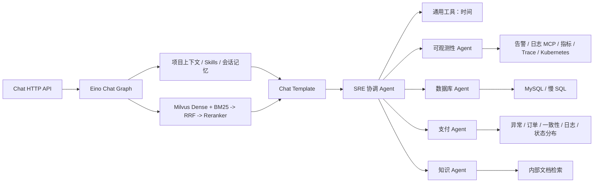

# SREagent

SREagent 是一个面向 SRE / OnCall 场景的智能排障后端服务，聚焦支付、订单、通知、告警、日志和数据库问题诊断。项目基于 GoFrame 和 CloudWeGo Eino ADK 构建，提供 HTTP API、工具调用、知识检索、会话记忆、权限控制和评估框架。

English documentation: [README_EN.md](README_EN.md)

## 核心能力

- 对话式排障：通过 `/api/chat` 和 `/api/chat_stream` 处理自然语言诊断请求。
- Agent 运行时：使用 Eino ADK ChatModelAgent，支持模型重试、备用模型 Failover 和动态工具搜索。
- 领域 Agent：聊天协调 Agent 通过 AgentTool 按需调用可观测性、数据库、支付和知识四个领域 Agent；每个领域只加载自己的工具。
- 证据驱动回答：优先使用告警、指标、日志、数据库、支付观测和知识库结果。
- 工具注册与权限控制：按场景注册工具，并通过角色范围限制高风险能力。
- 支付诊断工具：支持异常、指标、订单详情、一致性、日志和状态分布查询。
- 数据库诊断工具：支持 MySQL 只读查询、慢 SQL 诊断和写操作策略保护。
- 知识检索：支持本地 Markdown 文档切分，以及 Milvus Dense + BM25 + RRF 混合召回和外部 reranker。
- 会话记忆：支持对话历史、摘要、会话状态、长期记忆和工具结果持久化。
- 评估框架：支持 mock / smoke 模式，输出 JSONL 和 Markdown 报告。

## 当前架构



协调 Agent 不直接持有所有底层工具。工具注册表先执行角色权限过滤，再按领域构建 AgentTool；没有可用工具的领域不会暴露给当前用户。模型重试、Failover 和动态 Tool Search 会分别应用到协调 Agent 与领域 Agent。计划执行流水线暂不拆分，避免把所有流程一次性多 Agent 化。

## 项目结构

```text
api/                         HTTP API 请求和响应定义
internal/controller/          GoFrame 控制器
internal/ai/agent/            Chat、知识索引、计划执行等 Eino 编排
internal/ai/tools/            告警、日志、MySQL、支付、时间、知识库等工具
internal/ai/eval/             评估用例执行、评分和报告生成
internal/authz/               工具权限和风险策略
manifest/config/              服务配置示例
manifest/sql/                 MySQL 记忆表结构
scripts/                      本地调用脚本
testdata/eval/                评估用例
utility/                      客户端、记忆、通用工具和中间件
```

前端和 `docs/` 内容已从仓库中移除并被忽略。知识库文档可在本地按需放入 `docs/` 或配置的 `file_dir`，但不会提交到 Git。

## 环境要求

- Go 1.24.x
- MySQL 8.x 或兼容版本
- Milvus
- 可兼容 OpenAI API 的大模型服务
- 多模态 embedding 服务
- 可选：日志 MCP Streamable HTTP 服务

## 配置

默认配置文件位于 `manifest/config/config.yaml`。运行前需要根据本地环境调整：

```yaml
agent:
  invoke_model_retries: 1
  domain_agents:
    enabled: true
  failover:
    enabled: false
  tool_search:
    enabled: true
    min_tools: 8

database:
  default:
    host: "127.0.0.1"
    port: "3306"
    user: "YOUR_DATABASE_USER"
    pass: "YOUR_DATABASE_PASSWORD"
    name: "YOUR_DATABASE_NAME"

think_chat_model:
  api_key: "YOUR_CHAT_API_KEY"

quick_chat_model:
  api_key: "YOUR_CHAT_API_KEY"

failover_chat_model:
  api_key: "YOUR_FAILOVER_CHAT_API_KEY"
  base_url: "YOUR_FAILOVER_CHAT_API_BASE_URL"
  model: "FAILOVER_CHAT_MODEL"

embedding_model:
  api_key: "YOUR_EMBEDDING_API_KEY"

milvus:
  address: "localhost:19530"
  collection: "biz_hybrid_v1"
  dense_dimension: 1152
  bm25_analyzer: "standard"

knowledge_retrieval:
  hybrid_candidates: 12
  rrf_k: 60
  cache_ttl_seconds: 120
  cache_max_entries: 256

observability:
  enabled: false
  service_name: "sreagent"
  otlp_endpoint: "localhost:4317"
  insecure: true

tools:
  mysql:
    allow_write: false
```

启用观测后，Trace 会覆盖聊天请求、Eino 组件、Agent、知识检索和 reranker。核心指标包括请求成功率与耗时、流式首 Token 延迟、回答长度、证据数量、工具失败数、混合召回候选数、最终文档数和 reranker 成功率/耗时。

Agent 级指标包括 `sreagent.agent.runs`、`sreagent.agent.duration` 和 `sreagent.agent.routes`。它们使用固定的 Agent 名称、领域、类型、状态和流式标记作为低基数属性，可用于比较协调 Agent 与各领域 Agent 的调用量、成功率、路由分布和耗时。

预检索和 `query_internal_docs` 共用同一个 KnowledgeService。预检索成功且规范化查询未变化时，协调 Agent 会直接使用已注入文档，不再调用知识工具；同一租户、用户和会话中的相同规范化查询会在短期缓存内复用 Dense + BM25 + RRF + reranker 结果。失败结果不会缓存。

## 初始化数据库

创建会话记忆相关表：

```bash
mysql -u root -p < manifest/sql/memory_schema.sql
```

该脚本会创建 `superbiz_agent` 数据库以及对话、摘要、会话状态、长期记忆和工具结果表。

## 运行服务

```bash
go run .
```

服务默认监听：

```text
http://127.0.0.1:6872
```

主要 API：

```text
POST /api/chat
POST /api/chat_stream
POST /api/upload
POST /api/ai_ops
```

示例请求：

```bash
curl -sS -X POST "http://127.0.0.1:6872/api/chat" \
  -H "Content-Type: application/json; charset=utf-8" \
  -d '{
    "id": "demo-1",
    "userId": "local",
    "conversationId": "demo-1",
    "question": "支付系统最近是否有异常？请给出证据和建议。"
  }'
```

## 知识库索引

知识索引命令会读取本地 Markdown 文档，切分后写入 Milvus：

```bash
go run ./internal/ai/cmd/knowledge_cmd
```

混合检索使用新的 `biz_hybrid_v1` collection。升级后需要重新运行索引命令；旧 `biz` collection 不会被自动删除。`milvus.dense_dimension` 必须和 embedding 服务实际返回的维度一致。

默认命令读取当前工作目录下的 `docs/`。由于 `docs/` 被 Git 忽略，请在本地放置私有运行手册或知识库文件。

如需为 smoke 测试初始化最小知识文档，可显式指定测试文档目录：

```bash
go run ./internal/ai/cmd/knowledge_cmd -docs testdata/eval/fixtures
```

## 评估

运行 mock 评估：

```bash
go run ./internal/ai/cmd/eval_cmd -mode mock -cases testdata/eval/chat_cases.jsonl
```

运行 smoke 评估：

```bash
go run ./internal/ai/cmd/eval_cmd -mode smoke -cases testdata/eval/smoke_cases.jsonl
```

评估输出默认写入 `reports/`，该目录被 Git 忽略。
