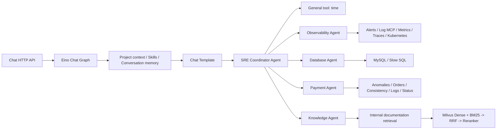

# SREagent

SREagent is a backend service for SRE and OnCall troubleshooting. It focuses on payment, order, notification, alert, log, and database diagnostics. The project is built with GoFrame and CloudWeGo Eino ADK, and provides HTTP APIs, tool calling, knowledge retrieval, conversation memory, authorization policies, and an evaluation framework.

中文文档: [README.md](README.md)

## Core Capabilities

- Conversational troubleshooting through `/api/chat` and `/api/chat_stream`.
- Eino ADK ChatModelAgent runtime with model retry, backup-model failover, and dynamic tool search.
- Domain agents: the chat coordinator invokes focused observability, database, payment, and knowledge agents through AgentTool; each domain loads only its own tools.
- Evidence-backed answers using alerts, metrics, logs, database results, payment observability, and knowledge retrieval.
- Scenario-based tool registration with role-based authorization.
- Generic MCP registration for multiple read-only MCP servers, with automatic discovery and domain/permission routing instead of one Go implementation per tool.
- Payment diagnostics for anomalies, metrics, order details, consistency checks, logs, and status distribution.
- Database diagnostics for MySQL read queries, slow SQL inspection, and write-operation safeguards.
- Knowledge retrieval from local Markdown files with Milvus Dense + BM25 + RRF hybrid recall and the existing external reranker.
- Conversation memory with history, summaries, session state, durable memory, and persisted tool results.
- Evaluation framework with Contract, Routing, and Smoke modes, producing per-attempt traces, quality scores, call-cost metrics, and stability reports.

## Current Architecture



The coordinator neither holds every leaf tool nor carries domain-specific tool selection and investigation order. It only selects the domain and enforces evidence scope. Payment, database, observability, and knowledge rules live in their corresponding domain agents. The registry first applies role-based authorization, then builds one AgentTool per non-empty domain. Retry, failover, and dynamic Tool Search apply independently to the coordinator and domain agents. The plan/execute pipeline remains unchanged so the project evolves incrementally instead of turning every flow into a multi-agent system at once.

## Repository Layout

```text
api/                         HTTP API request and response definitions
internal/controller/          GoFrame controllers
internal/ai/agent/            Eino orchestration for chat, indexing, and plan/execute flows
internal/ai/tools/            Alert, log, MySQL, payment, time, and knowledge tools
internal/ai/eval/             Evaluation runner, scoring, and report generation
internal/authz/               Tool permission and risk policies
manifest/config/              Example service configuration
manifest/sql/                 MySQL schema for conversation memory
scripts/                      Local helper scripts
testdata/eval/                Evaluation cases
utility/                      Clients, memory, common helpers, and middleware
```

Frontend assets and `docs/` content have been removed from the repository and are ignored by Git. Local knowledge documents can be placed in `docs/` or the configured `file_dir` when needed, but they are not committed.

## Requirements

- Go 1.24.x
- MySQL 8.x or compatible
- Milvus
- An OpenAI-compatible chat model provider
- A multimodal embedding service
- Optional: log MCP Streamable HTTP service

## Configuration

The default configuration lives at `manifest/config/config.yaml`. Adjust it before running locally:

```yaml
agent:
  invoke_model_retries: 1
  failover:
    enabled: false
  tool_search:
    enabled: true
    min_tools: 8

database:
  default:
    host: "127.0.0.1"
    port: "3306"
    user: "YOUR_DATABASE_USER"
    pass: "YOUR_DATABASE_PASSWORD"
    name: "YOUR_DATABASE_NAME"

think_chat_model:
  api_key: "YOUR_CHAT_API_KEY"

quick_chat_model:
  api_key: "YOUR_CHAT_API_KEY"

failover_chat_model:
  api_key: "YOUR_FAILOVER_CHAT_API_KEY"
  base_url: "YOUR_FAILOVER_CHAT_API_BASE_URL"
  model: "FAILOVER_CHAT_MODEL"

embedding_model:
  api_key: "YOUR_EMBEDDING_API_KEY"

milvus:
  address: "localhost:19530"
  collection: "biz_hybrid_v1"
  dense_dimension: 1152
  bm25_analyzer: "standard"

knowledge_retrieval:
  hybrid_candidates: 12
  rrf_k: 60
  cache_ttl_seconds: 120
  cache_max_entries: 256

observability:
  enabled: false
  service_name: "sreagent"
  otlp_endpoint: "localhost:4317"
  insecure: true

tools:
  mcp_servers:
    - name: "payment-platform"
      domain: "payment"
      url: "http://payment-mcp:8080/mcp"
      permission: "tool:payment.read"
      enabled: true
      required: false
      read_only: true
      headers_from_env:
        Authorization: "PAYMENT_MCP_AUTHORIZATION"
  mysql:
    allow_write: false
```

`tools.mcp_servers` accepts the `observability`, `database`, `payment`, and `knowledge` domains. At startup or first registration, each server is queried through MCP `tools/list`. Discovered tools are named `<server_name>__<tool_name>` and passed to the matching domain agent and ToolSearch. A server is not contacted when the current principal lacks its configured permission. Optional server failures degrade gracefully, while a failed `required: true` server returns a registration error.

The generic registry only accepts `read_only: true`. This is an operator declaration and cannot prove that a remote implementation has no side effects. Refunds, database writes, restarts, deployments, and other risky operations still require an explicit Go wrapper with validation, confirmation, and auditing. Header values are read only from environment variables so credentials do not need to be stored in YAML. Successfully discovered tools are cached for the process lifetime; restart the service after a tool-list change. Failed connections become retryable after a short delay.

When observability is enabled, traces cover chat requests, Eino components, the Agent, knowledge retrieval, and the reranker. Core metrics include request success and latency, streaming time to first token, answer length, evidence count, failed tools, hybrid candidate count, final document count, and reranker success/latency.

Agent-level metrics are `sreagent.agent.runs`, `sreagent.agent.duration`, and `sreagent.agent.routes`. They use fixed agent names, domains, kinds, statuses, and the streaming flag as low-cardinality attributes, allowing coordinator and domain-agent traffic, success rate, routing distribution, and latency to be compared.

The coordinator now calls `knowledge_agent` dynamically from the current request semantics; keyword-based pre-retrieval no longer injects documents into every matching request. `query_internal_docs` inside the knowledge agent uses the shared KnowledgeService. Dense + BM25 + RRF + reranker results are cached briefly for the same tenant, user, conversation, and normalized query. Failed retrievals are not cached.

## Database Setup

Create the conversation memory tables:

```bash
mysql -u root -p < manifest/sql/memory_schema.sql
mysql -u root -p superbiz_agent < manifest/sql/watcher_schema.sql
```

The scripts create the `superbiz_agent` database together with conversation-memory, detector-state, and incident tables. Existing MySQL data volumes do not rerun Docker initialization scripts, so apply the new `watcher_schema.sql` manually.

## Run The Service

```bash
go run .
```

The service listens on:

```text
http://127.0.0.1:6872
```

Main APIs:

```text
POST /api/chat
POST /api/chat_stream
POST /api/upload
POST /api/ai_ops
```

Example request:

```bash
curl -sS -X POST "http://127.0.0.1:6872/api/chat" \
  -H "Content-Type: application/json; charset=utf-8" \
  -d '{
    "id": "demo-1",
    "userId": "local",
    "conversationId": "demo-1",
    "question": "Are there any recent payment system anomalies? Provide evidence and recommendations."
  }'
```

## Periodic Anomaly Detection

The watcher is a single-replica worker separate from the HTTP service. It deterministically collects payment metrics, payment status distributions, and active Prometheus alerts. An incident opens only after the configured number of consecutive abnormal windows, and collection failures never count as recovery.

Set `watch.enabled: true` in the active configuration and verify that every payment rule's `value_path` and `sample_count_path` match the real payment-observability API response. Dot paths access nested fields and may contain array indexes, for example `data.0.success_rate`.

Evaluate every rule once:

```bash
go run ./internal/ai/cmd/watch_cmd -once
```

Run continuously:

```bash
go run ./internal/ai/cmd/watch_cmd
```

Deploy `watch_cmd` as a single replica in production instead of starting it in every API instance. Detector state is stored in `detector_states`; incident lifecycle and the latest evidence are stored in `incidents`. The first version implements collection, consecutive-window evaluation, incident opening/updating/resolution, and OTel metrics. Automatic domain-agent diagnosis and notifications are not included yet.

## Knowledge Indexing

The indexing command reads local Markdown documents, chunks them, and writes embeddings to Milvus:

```bash
go run ./internal/ai/cmd/knowledge_cmd
```

Hybrid retrieval uses the new `biz_hybrid_v1` collection. Run the indexing command again after upgrading; the old `biz` collection is not deleted automatically. `milvus.dense_dimension` must match the dimension returned by the embedding service.

By default, it reads `docs/` from the current working directory. Since `docs/` is ignored by Git, keep private runbooks and knowledge documents locally.

## Evaluation

Start with deterministic unit tests:

```bash
go test ./...
```

Run Contract evaluation. `model_steps` explicitly controls model behavior to test orchestration, tool execution, evidence handling, degradation, and failover. Expected results never drive the model:

```bash
go run ./internal/ai/cmd/eval_cmd -mode contract
```

Run Routing evaluation. It uses the real model configured by `config.local.yaml` with deterministic fixture tools. Each case runs three times by default and the default quality gate is 90%:

```bash
go run ./internal/ai/cmd/eval_cmd -mode routing
```

Run end-to-end Smoke evaluation:

```bash
go run ./internal/ai/cmd/eval_cmd -mode smoke
```

Use `-repetitions`, `-case-timeout`, and `-min-pass-rate` to change repetition count, per-case timeout, and the quality gate. Any failed Safety attempt independently fails the gate. A model or tool API failure is recorded as that attempt's result while the remaining cases continue. Reports are written to `reports/` by default. This directory is ignored by Git.

Subjective answer quality does not call another model by default. Semantic judging runs only when a case defines `judge_criteria` and the command includes `-judge`. Routing, tools, arguments, evidence IDs, call budgets, and safety rules always use deterministic scoring.

