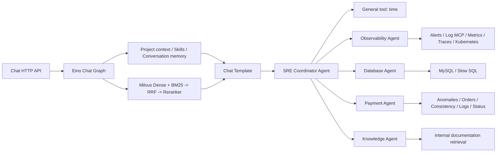

# SREagent

SREagent is a backend service for SRE and OnCall troubleshooting. It focuses on payment, order, notification, alert, log, and database diagnostics. The project is built with GoFrame and CloudWeGo Eino ADK, and provides HTTP APIs, tool calling, knowledge retrieval, conversation memory, authorization policies, and an evaluation framework.

中文文档: [README.md](README.md)

## Core Capabilities

- Conversational troubleshooting through `/api/chat` and `/api/chat_stream`.
- Eino ADK ChatModelAgent runtime with model retry, backup-model failover, and dynamic tool search.
- Domain agents: the chat coordinator invokes focused observability, database, payment, and knowledge agents through AgentTool; each domain loads only its own tools.
- Evidence-backed answers using alerts, metrics, logs, database results, payment observability, and knowledge retrieval.
- Scenario-based tool registration with role-based authorization.
- Payment diagnostics for anomalies, metrics, order details, consistency checks, logs, and status distribution.
- Database diagnostics for MySQL read queries, slow SQL inspection, and write-operation safeguards.
- Knowledge retrieval from local Markdown files with Milvus Dense + BM25 + RRF hybrid recall and the existing external reranker.
- Conversation memory with history, summaries, session state, durable memory, and persisted tool results.
- Evaluation framework with mock and smoke modes, producing JSONL and Markdown reports.

## Current Architecture



The coordinator does not hold every leaf tool. The registry first applies role-based authorization, then builds one AgentTool per non-empty domain. Retry, failover, and dynamic Tool Search apply independently to the coordinator and domain agents. The plan/execute pipeline remains unchanged so the project evolves incrementally instead of turning every flow into a multi-agent system at once.

## Repository Layout

```text
api/                         HTTP API request and response definitions
internal/controller/          GoFrame controllers
internal/ai/agent/            Eino orchestration for chat, indexing, and plan/execute flows
internal/ai/tools/            Alert, log, MySQL, payment, time, and knowledge tools
internal/ai/eval/             Evaluation runner, scoring, and report generation
internal/authz/               Tool permission and risk policies
manifest/config/              Example service configuration
manifest/sql/                 MySQL schema for conversation memory
scripts/                      Local helper scripts
testdata/eval/                Evaluation cases
utility/                      Clients, memory, common helpers, and middleware
```

Frontend assets and `docs/` content have been removed from the repository and are ignored by Git. Local knowledge documents can be placed in `docs/` or the configured `file_dir` when needed, but they are not committed.

## Requirements

- Go 1.24.x
- MySQL 8.x or compatible
- Milvus
- An OpenAI-compatible chat model provider
- A multimodal embedding service
- Optional: log MCP Streamable HTTP service

## Configuration

The default configuration lives at `manifest/config/config.yaml`. Adjust it before running locally:

```yaml
agent:
  invoke_model_retries: 1
  domain_agents:
    enabled: true
  failover:
    enabled: false
  tool_search:
    enabled: true
    min_tools: 8

database:
  default:
    host: "127.0.0.1"
    port: "3306"
    user: "YOUR_DATABASE_USER"
    pass: "YOUR_DATABASE_PASSWORD"
    name: "YOUR_DATABASE_NAME"

think_chat_model:
  api_key: "YOUR_CHAT_API_KEY"

quick_chat_model:
  api_key: "YOUR_CHAT_API_KEY"

failover_chat_model:
  api_key: "YOUR_FAILOVER_CHAT_API_KEY"
  base_url: "YOUR_FAILOVER_CHAT_API_BASE_URL"
  model: "FAILOVER_CHAT_MODEL"

embedding_model:
  api_key: "YOUR_EMBEDDING_API_KEY"

milvus:
  address: "localhost:19530"
  collection: "biz_hybrid_v1"
  dense_dimension: 1152
  bm25_analyzer: "standard"

knowledge_retrieval:
  hybrid_candidates: 12
  rrf_k: 60
  cache_ttl_seconds: 120
  cache_max_entries: 256

observability:
  enabled: false
  service_name: "sreagent"
  otlp_endpoint: "localhost:4317"
  insecure: true

tools:
  mysql:
    allow_write: false
```

When observability is enabled, traces cover chat requests, Eino components, the Agent, knowledge retrieval, and the reranker. Core metrics include request success and latency, streaming time to first token, answer length, evidence count, failed tools, hybrid candidate count, final document count, and reranker success/latency.

Agent-level metrics are `sreagent.agent.runs`, `sreagent.agent.duration`, and `sreagent.agent.routes`. They use fixed agent names, domains, kinds, statuses, and the streaming flag as low-cardinality attributes, allowing coordinator and domain-agent traffic, success rate, routing distribution, and latency to be compared.

Pre-retrieval and `query_internal_docs` share one KnowledgeService. When pre-retrieval succeeds and the normalized query has not changed, the coordinator uses the injected documents instead of calling the knowledge tool again. Dense + BM25 + RRF + reranker results are cached briefly for the same tenant, user, conversation, and normalized query. Failed retrievals are not cached.

## Database Setup

Create the conversation memory tables:

```bash
mysql -u root -p < manifest/sql/memory_schema.sql
```

The script creates the `superbiz_agent` database and tables for conversations, summaries, session state, durable memories, and tool results.

## Run The Service

```bash
go run .
```

The service listens on:

```text
http://127.0.0.1:6872
```

Main APIs:

```text
POST /api/chat
POST /api/chat_stream
POST /api/upload
POST /api/ai_ops
```

Example request:

```bash
curl -sS -X POST "http://127.0.0.1:6872/api/chat" \
  -H "Content-Type: application/json; charset=utf-8" \
  -d '{
    "id": "demo-1",
    "userId": "local",
    "conversationId": "demo-1",
    "question": "Are there any recent payment system anomalies? Provide evidence and recommendations."
  }'
```

## Knowledge Indexing

The indexing command reads local Markdown documents, chunks them, and writes embeddings to Milvus:

```bash
go run ./internal/ai/cmd/knowledge_cmd
```

Hybrid retrieval uses the new `biz_hybrid_v1` collection. Run the indexing command again after upgrading; the old `biz` collection is not deleted automatically. `milvus.dense_dimension` must match the dimension returned by the embedding service.

By default, it reads `docs/` from the current working directory. Since `docs/` is ignored by Git, keep private runbooks and knowledge documents locally.

## Evaluation

Run mock evaluation:

```bash
go run ./internal/ai/cmd/eval_cmd -mode mock -cases testdata/eval/chat_cases.jsonl
```

Run smoke evaluation:

```bash
go run ./internal/ai/cmd/eval_cmd -mode smoke -cases testdata/eval/smoke_cases.jsonl
```

Reports are written to `reports/` by default. This directory is ignored by Git.

